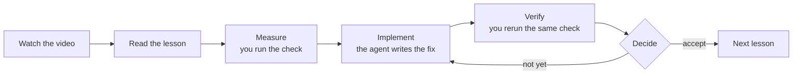
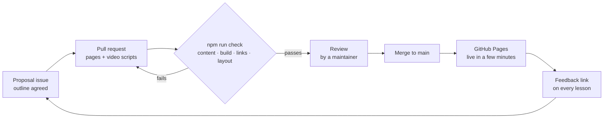

# Testbench

**A tutorial website for software testing.** Every page is a short narrated video with the written lesson underneath. Every hands-on exercise splits the work: you run the checks and read the numbers, a coding agent writes the fix, and you check the result and decide.

**Live site:** https://johnsonnoronathan.github.io/demo/

| | |
| --- | --- |
| **For learners** | *Writing Test Cases* is for beginners: short lessons, each ending with a quiz. *Performance Testing* is intermediate: from a first measurement to a formal acceptance test, then the same checks on your own project. The catalog on the site lists every course with its length. Progress, watched video time and quiz scores are saved in your browser. |
| **For agents** | Each exercise has a **Copy prompt** button that hands the implementation to Claude Code or another coding agent. Every page is also published as Markdown, and the site's `/llms.txt` lists them all. |
| **For contributors** | A new tutorial is content, not code: one Markdown file and one video script per page. A pull request adds it, automatic checks keep it from breaking the layout, and merging publishes it. |

**Languages.** The site's menus and buttons are in 7 languages (English, Chinese, Japanese, Korean, Spanish, French, German). English is the source language for every course, and the courses are translated into Chinese as well. Anything not yet translated, including the other five languages' lesson text, shows in English with a notice saying so.

**Words used below.** A *course* has *chapters*, and a chapter has *pages*. Most pages are *lessons*. A chapter can also start with an *opening* page (what you'll get) and end with a *summary* page. "Lesson 4.3" means chapter 4, lesson 3.

## How it works

### A lesson

Every exercise follows the same loop, called the **learner/agent split**: the learner measures, the agent implements, and the learner verifies and decides.



The agent's prompt forbids it from loosening a limit to make a check pass, and your rerun is the number that counts. You can do the "implement" step yourself instead; a coding agent is optional, but it's how the course expects real work to get done. *Performance Testing* ends with this loop at full scale: an acceptance test with a go/no-go decision (lesson 4.3), then the same checks on your own codebase (lesson 4.4).

### From an idea to the live site

The site is static and has no server. GitHub does that job instead: ideas and feedback arrive as **issues**, content arrives as **pull requests**, and **GitHub Pages** serves the site.



- **The checks** run on every pull request and enforce the checked rules in [`academy/STANDARD.md`](academy/STANDARD.md). A failure names its rule, for example `P3` (every page has a video):
  - content rules: every page has a video, every exercise has the learner/agent split, and translations match the English
  - a production build, then a check of every link
  - every page opened in a real browser at phone and desktop width, so nothing scrolls sideways or throws an error
- **The review** covers what a program can't judge, such as real numbers and pacing. These are the *R rules* in the same standard, and the pull request template turns them into a checklist. A repository maintainer reviews and merges.
- **Feedback.** Every lesson ends with a **Suggest an improvement** link. It opens a GitHub issue with the page already filled in.

## What a tutorial is made of

Everything lives under [`academy/`](academy/), the site's folder. A tutorial needs three kinds of file:

```text
academy/src/content/courses.yaml                      the course: title, level, outcomes, chapters
academy/src/content/lessons/en/<course>/
    1-<chapter>/0-opening.mdx                         one file per page (MDX = Markdown plus a few components)
    1-<chapter>/1-<slug>.mdx
academy/src/videos/en/<course>/<chapter>/<slug>.ts    one video script per page ("opening.ts" for an opening)
```

How the names fit together:

- `<course>` and `<chapter>` are ids from `courses.yaml`: today `test-cases` (chapters `foundations`, `design`, `automation`) and `performance-testing` (`overview`, `static`, `dynamic`, `review`).
- The site finds pages by their folders. `courses.yaml` changes only when you add a course or a chapter, never for a lesson.
- The number in front of a folder or file is only for sorting in your editor. A page's position comes from `order:` in its header, and its address from `slug:`. Its video file is named after the slug.
- Lesson numbers such as "2.3" are worked out from position. If you insert a lesson mid-chapter, `npm run check` lists every video title card that needs a new number.

A page is Markdown, with its facts in a header:

```mdx
---
title: "Status codes"
course: api-testing
chapter: basics
kind: lesson
order: 1
slug: status-codes
exercises:
  - id: check-codes
    title: "Check the error codes of your API"
    minutes: 15
    target: own                      # runs in the learner's own repository
    goal: "Every protected endpoint answers 401 without a token."
    agent:                           # the agent's part: the site turns this into the Copy prompt
      steps: ["Call each protected endpoint without a token and quote the status", "Fix any that don't return 401"]
      done: ["Every protected endpoint returns 401 without a token"]
      report: ["Before and after status codes, quoted from real output"]
---

A status code is the first thing a client reads. …

<Exercise id="check-codes">
1. Call the endpoint without a token and note the status code.   <!-- your part: measure -->
2. Copy the prompt below; the agent fixes what's wrong.
3. Run step 1 again yourself. Your result is the one that counts.
</Exercise>
```

A lesson without hands-on work ends with a `quiz:` instead. Every page needs a video, openings and summaries included.

A video isn't a video file. It's a script of narration lines (*cues*) and what's on screen (*panes*). The browser plays it with captions, chapters and speech, so translating a video only changes the words:

```ts
export default defineVideo({
  title: "Status codes",
  scenes: [
    { label: "Introduction",
      cues: ["A status code is the first thing a client reads."],
      panes: [{ type: "title", kicker: "Lesson 1.1 · Basics", heading: "Status codes" }] },
  ],
});
```

Translations are optional. They go in the same folders under another language code (`lessons/zh/…`, `videos/zh/…`). Untranslated pages show the English with a notice.

## Add a tutorial

1. **Propose it, if it's a new course or chapter.** Open a [Propose a tutorial](https://github.com/johnsonnoronathan/demo/issues/new?template=tutorial-proposal.yml) issue. The form asks for the audience, outcomes, chapters and how learners will check their work. Wait for a maintainer to agree the outline before writing pages. A single new lesson, a fix or a translation needs no proposal: go straight to step 2.
2. **Write it** on a branch, following [`academy/STANDARD.md`](academy/STANDARD.md). The quickest start is a coding agent:
   - **With Claude Code:** open this repository and ask, for example, "add a lesson on exploratory testing to Writing Test Cases". Claude Code finds the [`new-tutorial`](.claude/skills/new-tutorial/SKILL.md) skill in this repository and uses it for requests like this (or ask for it by name: `/new-tutorial`). It walks the agent through the standard, gives it templates, and runs the checks.
   - **With another agent, or by hand:** follow the same skill file, and copy the templates in `.claude/skills/new-tutorial/templates/`.
3. **Check it.** Run `npm run check` in `academy/` until it passes.
4. **Send it.** Open a pull request, fill in the checklist, and wait for review. Merging publishes it.

## Run it locally

You need Node.js 22.13 or later.

```bash
cd academy
npm install
npm run dev        # the site at http://localhost:4321
npm run check      # the same checks a pull request runs (about a minute)
```

## What's where

| Path | What it is |
| --- | --- |
| [`academy/`](academy/) | The site (built with Astro). [`academy/README.md`](academy/README.md) explains its parts in detail. |
| [`academy/STANDARD.md`](academy/STANDARD.md) | The rules every tutorial meets: checked rules (with IDs) and review rules (R) |
| `academy/src/content/` | `courses.yaml`, and the pages of every course, per language |
| `academy/src/videos/` | Video scripts, per language |
| [`academy/practice/larkspur/`](academy/practice/larkspur/) | A bookshop app that is slow on purpose; Performance Testing's exercises run against it |
| [`.claude/skills/new-tutorial/`](.claude/skills/new-tutorial/) | The skill an agent follows to add a tutorial, with templates |
| `.github/` | The pull request checks, publishing to GitHub Pages, issue forms, the pull request template |

Also in this repository: [Skeleton Lab](skeletons/), a separate demo of loading-skeleton effects.
