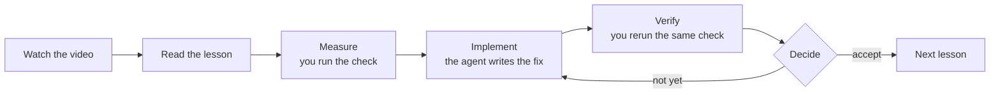
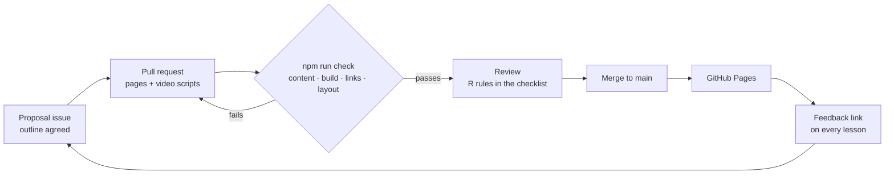

# Testbench

**A tutorial website for software testing.** Every page is a short narrated video with the written lesson underneath. Every hands-on exercise splits the work: you run the checks and read the numbers, a coding agent implements the fix, and you verify it and decide.

**Live site:** https://johnsonnoronathan.github.io/demo/

| | |
| --- | --- |
| **For learners** | Two courses: *Writing Test Cases* (beginner, 6 lessons) and *Performance Testing* (intermediate, 22 pages, from first measurement to a formal acceptance test and your own project). Progress, watched video time and quiz scores are saved in your browser. The interface is in 7 languages; English and Chinese are fully translated. |
| **For agents** | Each exercise has a **Copy prompt** button that hands the implementation to Claude Code or another coding agent. Every page also has a Markdown version, and `/llms.txt` lists them all. |
| **For contributors** | A new tutorial is content, not code: Markdown pages plus video scripts. A pull request adds it, automatic checks keep the layout from breaking, and a merge publishes it. |

## How it works

### A lesson

Every exercise follows the same loop, so learning ends in a result you have checked yourself:



The agent never loosens a limit to make a check pass, and your rerun is the number that counts. *Performance Testing* ends with this loop at full scale: an acceptance test with a go/no-go decision (lesson 4.3), then the same checks on your own codebase (lesson 4.4).

### From a pull request to the live site

The site is static and has no backend: GitHub is both the inbox and the publisher.



- **Content** is three things: a course entry in `courses.yaml`, one MDX file per page, and one video script per page. The site's pages, video player and progress tracking are shared by every course.
- **The checks** enforce [`academy/STANDARD.md`](academy/STANDARD.md):
  - content rules: every page has a video, every exercise has the learner/agent split, translations match the English
  - a production build and a check of every link
  - every page opened in a real browser at phone and desktop width
- **Videos** are not video files. Each is a script of narration cues and on-screen panes. The browser plays it with captions, chapters and speech, so a translation only changes the words.

## Run it locally

```bash
cd academy
npm install
npm run dev        # http://localhost:4321
npm run check      # the same checks a pull request runs
```

## Add a tutorial

1. Open a **Propose a tutorial** issue and agree the outline.
2. Write it on a branch. With Claude Code, the [`new-tutorial`](.claude/skills/new-tutorial/SKILL.md) skill walks the agent through the standard and runs the checks.
3. Open a pull request. When the checks pass and a reviewer approves, merging publishes it.

## What's where

| Path | What it is |
| --- | --- |
| [`academy/`](academy/) | The site (Astro + MDX). [`academy/README.md`](academy/README.md) explains its parts in detail. |
| [`academy/STANDARD.md`](academy/STANDARD.md) | The rules every tutorial meets, checked and reviewed |
| `academy/src/content/` | Courses and pages, per language |
| `academy/src/videos/` | Video scripts, per language |
| [`academy/practice/larkspur/`](academy/practice/larkspur/) | The slow-on-purpose bookshop app that Performance Testing's exercises run against |
| [`.claude/skills/new-tutorial/`](.claude/skills/new-tutorial/) | The skill an agent follows to add a tutorial |
| `.github/` | Pull request checks, publishing, issue forms |
| [`skeletons/`](skeletons/) | Skeleton Lab, a separate demo (below) |

## Skeleton Lab

[`skeletons/index.html`](skeletons/index.html) is a single self-contained page with four loading-skeleton effects. Each one runs on a realistic mini webpage. Open the file in a browser; there is nothing to install or build.

```bash
cd skeletons && python3 -m http.server 8765   # or just open index.html
```

| Effect | Page | What happens | Reveal |
| --- | --- | --- | --- |
| **Pulse and cross-blur** | Birding feed | Bones pulse between full and half opacity (1000 ms, ease-in-out). | Skeleton and content cross-fade with a shared 2 px blur over 400 ms. Both layers share one grid cell, so the swap causes no layout shift. |
| **Synced shimmer sweep** | News article | One 105° highlight band crosses the whole page. Every bone paints the same page-sized gradient, offset by its own position, so the band stays continuous across gaps. | Blocks rise 12 px and unblur from 3 px in reading order, 60 ms apart, on `cubic-bezier(0.22, 1, 0.36, 1)`. |
| **Ripple wave** | Ceramics shop grid | Each bone flashes on a delay of 1.1 ms per pixel of distance from the top-left corner, so a crest rolls diagonally through the grid. | Cards pop in (scale 0.97 → 1, slight overshoot) in the same order the wave travels. |
| **Dot wireframe build** | Generated sales dashboard | A dot field ripples out from the centre. The real DOM is measured and traced in dots: boxes, text lines, table rules and the chart's SVG path. | A scan line moves down and reveals the real UI, fading and sharpening as it passes. |

The toolbar replays all effects. It also has slow motion (½×, ¼×), a **Hold skeleton** switch that keeps every skeleton in its loading state until you turn it off, and a theme toggle. Each effect has a live timeline showing its phases and durations.

All of it is plain CSS and vanilla JavaScript with no dependencies. Fonts come from Google Fonts and fall back to system fonts. With `prefers-reduced-motion: reduce`, skeletons hold still and every swap becomes a 200 ms fade.

### Credits

The patterns and timings are adapted from [transitions.dev](https://github.com/Jakubantalik/transitions.dev) by Jakub Antalik: *Skeleton loader and reveal*, *Texts reveal*, *Shimmer text* and the *UI generation* skill. Durations, distances, blurs and easings follow its motion tokens. The code in this repository is a new implementation, not a copy of that library.
